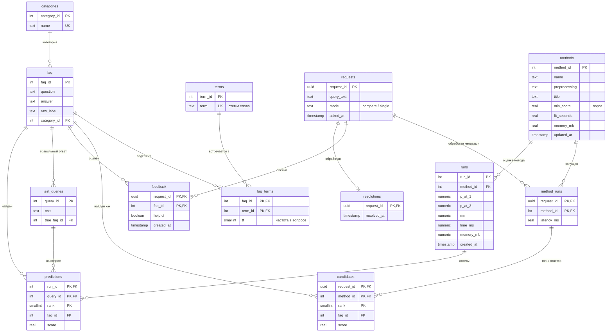

# ER-диаграмма базы данных

PostgreSQL 16, схема в третьей нормальной форме (`sql/init/01_schema.sql`). GitHub отображает диаграмму автоматически.

## Логика схемы

| Блок | Таблицы | Зачем так |
|---|---|---|
| Корпус | `faq`, `categories` | вопросы и ответы датасета; категории — после сведения 422 исходных меток |
| Обратный индекс | `terms`, `faq_terms` | связь «многие-ко-многим» вопрос ↔ стемм; по ней SQL считает частоты, документную частоту, TF-IDF и находит почти-дубликаты |
| Методы | `methods` | порог `min_score`, время подготовки и память каждого метода |
| Работа бота | `requests` → `method_runs` → `candidates` | вопрос хранится один раз; запуск метода (время поиска) отдельно от его топ-k кандидатов — время относится к паре «запрос-метод», а не к каждому кандидату |
| Оценки | `feedback`, `resolutions` | пользователь оценивает **ответ** (запрос + faq_id), а не метод: засчитан ли метод, вычисляется — так одна оценка автоматически распределяется между всеми методами, вернувшими этот ответ |
| Оценка на тестах | `test_queries`, `runs`, `predictions` | Precision@k и MRR на размеченных вопросах |

Вычисляемые данные — **представления** (`sql/init/03_views.sql`), а не таблицы:

- `v_method_answers` — ответ каждого метода на каждый запрос: найден ли (оценка ≥ порога метода) и засчитан ли (по отзывам);
- `v_unanswered` — вопросы без подходящего ответа (`not_found` / `bad_answer`) с ближайшим кандидатом, кроме обработанных.

Аналитические запросы к схеме — `queries.sql` (12 запросов: JOIN, self-JOIN, GROUP BY / HAVING, подзапросы EXISTS / NOT EXISTS, CTE, LATERAL, оконные ROW_NUMBER / RANK / DENSE_RANK / SUM OVER / LAG).
